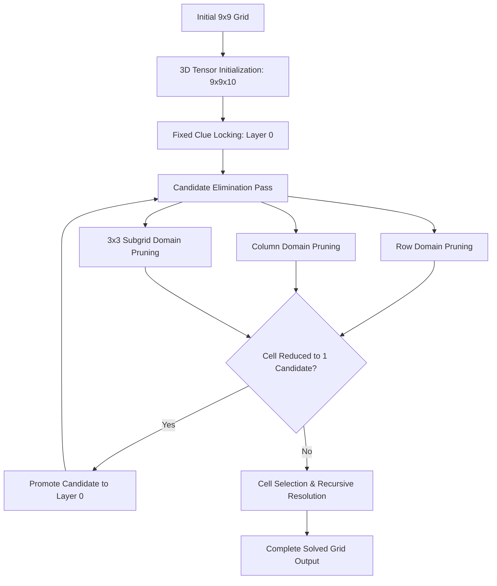

# 🧩 Sudoku Solver Engine

<p align="center">
  
</p>

> **High-Performance C++ Algorithmic Sudoku Engine** featuring a **3D Candidate Tensor Representation (`[9][9][10]`)**, deterministic constraint satisfaction, forward checking, and candidate elimination.

[](https://en.wikipedia.org/wiki/C%2B%2B)
[](https://en.wikipedia.org/wiki/Constraint_satisfaction_problem)
[](LICENSE)

---

## 📌 Executive Summary

The **Sudoku Solver Engine** is an algorithmic exploration into solving NP-complete grid satisfaction puzzles using a **multidimensional candidate tracking model**. Rather than brute-force naive recursion, this engine represents the 9×9 puzzle space as a **3D Tensor (`9 × 9 × 10`)**:

- **Layer 0 (`[row][col][0]`):** Current determined cell state (`-1` represents an unassigned cell; `1–9` represents the solved value).
- **Layers 1–9 (`[row][col][1..9]`):** Discrete boolean domain tracking representing remaining active candidate possibilities for cell `(row, col)`.

Through this representation, row, column, and 3×3 subgrid elimination routines operate via fast direct array indexing, enabling deterministic forward deduction before any backtracking steps.

---

## 📐 Algorithmic Architecture & Design

### 1. 3D Candidate Space Tensor
Traditional solvers often use simple 2D arrays with recursive trial-and-error. This engine implements **Constraint Propagation** inspired by the AC-3 (Arc Consistency) paradigm:



### 2. Elimination Subroutines
- **`sudoku_3d_updater`**: Synchronizes known values from the 2D grid into Layer 0 while zeroing out impossible candidates.
- **`row_possibility_elimination`**: Scans horizontal lines to strike out claimed digits from peer candidate sets.
- **`column_possibility_elimination`**: Scans vertical columns to prune conflicting domains.
- **`cell_selection`**: Deterministic selection heuristic identifying the most constrained cell (MRV - Minimum Remaining Values) to resolve next.

---

## 💻 Tech Stack & Specifications

| Component | Specification |
| :--- | :--- |
| **Language** | C++17 / C++20 Standard |
| **Data Structures** | Fixed multidimensional arrays (`int[9][9]`, `int[9][9][10]`) |
| **Memory Allocation** | Zero dynamic heap allocation during runtime (100% stack-allocated deterministic cache-locality) |
| **Algorithmic Category** | Constraint Satisfaction Problem (CSP) / Forward Checking / Backtracking |
| **Compiler Support** | Clang (`clang++`), GCC (`g++`), MSVC (`cl.exe`) |

---

## 🚀 Building & Running

### Prerequisites
- Any modern C++ compiler (`clang++`, `g++`, or Visual Studio MSVC).

### Compile with Optimizations
```bash
# Clone the repository
git clone https://github.com/itismemuhammadali/Sudoku-Solver-Engine.git
cd Sudoku-Solver-Engine

# Compile with release optimizations (-O3)
clang++ -O3 -std=c++17 Main.cpp -o sudoku_engine
# OR with GCC:
# g++ -O3 -std=c++17 Main.cpp -o sudoku_engine
```

### Execute
```bash
./sudoku_engine
```

---

## 📊 Algorithmic Complexity

- **Time Complexity:**
  - *Best Case (Deterministic Deduction):* $\mathcal{O}(N^3)$ where $N = 9$, resolving purely through constraint propagation passes.
  - *Worst Case (Search Tree Traversal):* Exponential bound $\mathcal{O}(9^{M})$ where $M$ is the number of empty cells, heavily mitigated by the 3D domain pruning heuristics.
- **Space Complexity:**
  - $\mathcal{O}(1)$ strict auxiliary space ($9 \times 9 \times 10 \times 4 \text{ bytes} \approx 3.24 \text{ KB}$), achieving maximum L1 CPU cache residency.

---

## 👤 Author

- **Muhammad Ali**
  - **GitHub:** [@itismemuhammadali](https://github.com/itismemuhammadali)
